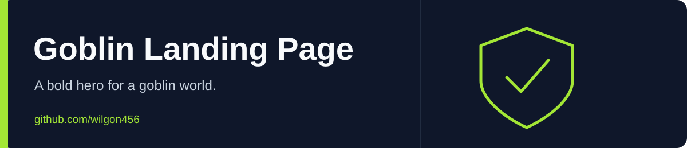

<div align="center">



# Goblin Landing Page

반응형 메뉴와 스크롤 애니메이션을 더한 게임풍 랜딩 페이지입니다.

[English](README.md) · **한국어**

 

[Repository](https://github.com/wilgon456/website_goblinDesign)

</div>

---

## 특징

- 고블린 일러스트와 버튼을 담은 첫 화면
- 작은 화면에서 펼쳐지는 탐색 메뉴
- 첫 화면·소셜 링크·스크롤 안내의 ScrollReveal 애니메이션
- Poppins와 Permanent Marker를 사용한 CSS 구성

## 로컬 미리보기

```bash
git clone https://github.com/wilgon456/website_goblinDesign.git
cd website_goblinDesign
python3 -m http.server 8000
```

**http://localhost:8000**을 엽니다. 빌드는 필요 없습니다. 글꼴·아이콘·ScrollReveal은 외부 서비스에서 불러옵니다.

## 수정할 곳

| 파일 | 내용 |
| --- | --- |
| `index.html` | 탐색 메뉴·첫 화면·버튼·소셜 링크 |
| `style.css` | 배치·반응형 규칙 |
| `app.js` | 메뉴 열기·ScrollReveal 설정 |
| `main.png` / `pngwing.com.png` | 포함된 이미지 |

버튼과 메뉴 링크는 예시입니다. 게임 테마를 참고한 독립적인 화면 학습 프로젝트이며 공식 게임 서비스가 아닙니다. 다른 곳에 이미지를 재사용하기 전에는 권리를 확인해 주세요.
